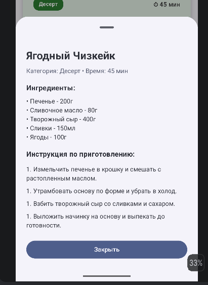

# Foodgramm 🍔

An interactive Android application for discovering, filtering, and saving recipes. Built with **Kotlin**, **Jetpack Compose**, and **Material 3**, utilizing the **MVVM** architecture pattern.

---

## 🚀 Features

* **Interactive Recipe Deck**: Browse recipes card-by-card with simple action buttons to **Save** ❤️ or **Skip** ❌.
* **Smart Search**: Search for any recipe globally by its title.
* **Category Filtering**: Filter recipes using Material 3 `FilterChips` (*Main Course, Dessert, Breakfast, Snack, Drinks*).
* **Dual View Modes**: Switch automatically between a single card deck view and a vertical `LazyColumn` list when searching or filtering.
* **Detailed Recipe Bottom Sheet**: Tap any recipe card to view full ingredients and step-by-step cooking instructions via `ModalBottomSheet`.
* **State Management**: Robust state preservation across configuration changes (e.g., screen rotation) using `ViewModel` and `StateFlow`.

---

## 🛠 Tech Stack & Architecture

* **Language**: Kotlin
* **UI Framework**: Jetpack Compose, Material 3
* **Architecture**: MVVM (Model-View-ViewModel)
* **State Management**: `StateFlow`, `remember`, `rememberSaveable`
* **Asynchronous Programming**: Kotlin Coroutines
* **Build System**: Gradle

---

## 📱 Screenshots

| Main Screen (Deck) | Search & Filter List | Recipe Details |
| :---: | :---: | :---: |
|  |  |  |

*(Note: Store screenshot images inside the `screenshots/` directory in the repository root).*

---

## ⚙️ How to Run

1. **Clone the repository**:
   ```bash
   git clone [https://github.com/akineverused/android_hw2.git](https://github.com/akineverused/android_hw2.git)
   ```
2. **Run the app on an emulator**
   
