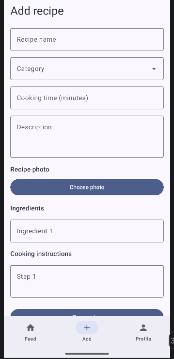
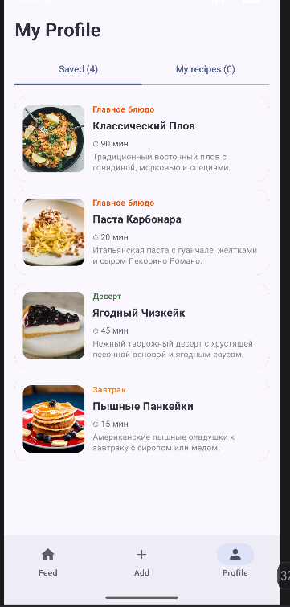
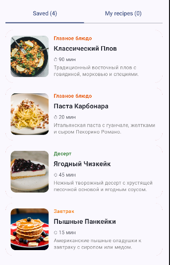

# Foodgram 🍔

**Foodgram** is an interactive Android application for discovering, browsing, and saving recipes. Users can explore recipes through an interactive card deck, search by title, filter by category, view detailed cooking instructions, and add their own recipes.

Built with **Kotlin**, **Jetpack Compose**, and **Material 3**, following the **MVVM** architecture pattern.

---

## 🚀 Features

- **Interactive Recipe Deck** — Browse recipes one card at a time and save or skip recipes.
- **Recipe Search** — Find recipes by title.
- **Category Filtering** — Filter recipes by category using Material 3 `FilterChip` components.
- **Multiple Viewing Modes** — Browse recipes in an interactive deck or a vertical list when searching or filtering.
- **Recipe Details** — View recipe descriptions, ingredients, cooking time, and step-by-step instructions in a `ModalBottomSheet`.
- **Saved Recipes** — View and manage saved recipes in the profile section.
- **Add Your Own Recipes** — Create recipes with a title, category, cooking time, description, ingredients, instructions, and an image.
- **User Profiles** — View your own recipes and explore recipes associated with other authors.
- **Swipe Interactions** — Use swipe gestures to manage recipes in the profile.
- **Reactive UI** — Update the interface in response to state changes using `ViewModel` and `StateFlow`.

## 🛠 Tech Stack

- **Language:** Kotlin
- **UI Framework:** Jetpack Compose
- **Design System:** Material 3
- **Architecture:** MVVM (Model–View–ViewModel)
- **State Management:** `StateFlow`, `remember`, `rememberSaveable`
- **Asynchronous Programming:** Kotlin Coroutines
- **Image Loading:** Coil 3
- **Navigation:** Navigation Compose
- **Build System:** Gradle

## 🏗 Project Structure

The application is organized into several main parts:

- **Model** — Recipe data models.
- **ViewModel** — Application state and recipe-related operations.
- **Screens** — Main feed, recipe creation, profiles, and recipe browsing.
- **Components** — Reusable UI elements, including recipe cards and recipe detail sheets.
- **Navigation** — Navigation between application screens.
- **UI Theme** — Application colors, typography, and Material 3 styling.

## 📱 Screenshots

|                 Main Feed                 |                   Search & Categories                   |                  Recipe Details                  |
|:-----------------------------------------:|:-------------------------------------------------------:|:------------------------------------------------:|
|  |  |  |

|                Add Recipe                 |               User Profile               |                  Saved Recipes                  |
|:-----------------------------------------:|:----------------------------------------:|:-----------------------------------------------:|
|  |  |  |

## ⚙️ How to Run

1. Clone the repository:

   ```bash
   git clone https://github.com/akineverused/android_hw2.git
   ```

2. Open the project in **Android Studio**.

3. Allow Gradle to sync and download the required dependencies.

4. Start an Android emulator or connect an Android device.

5. Click **Run** in Android Studio to build and launch the application.

## 📌 Notes

- The application uses sample recipes for demonstration.
- Recipe and profile data are managed through the application's current state-management implementation.
