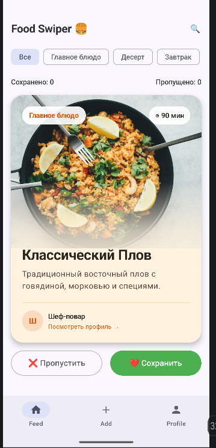
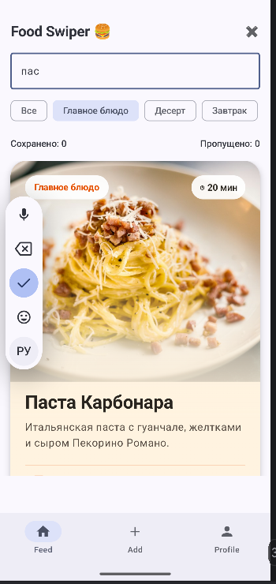
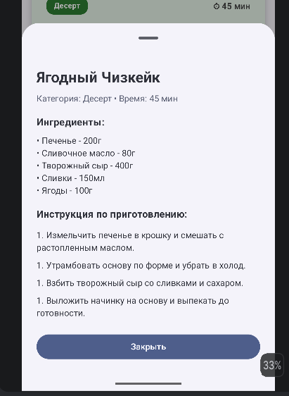
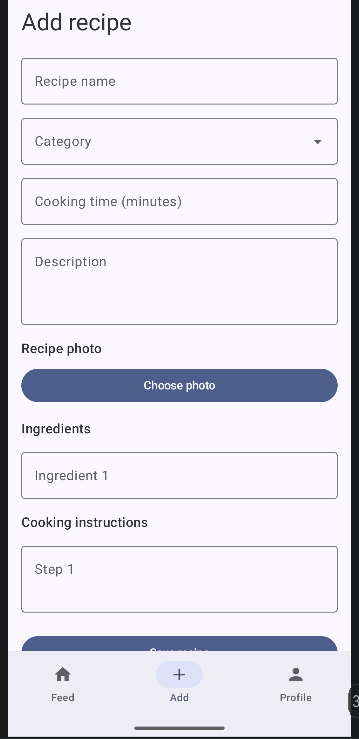
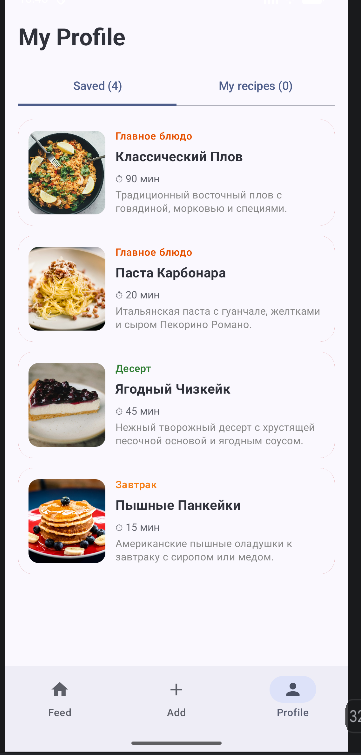
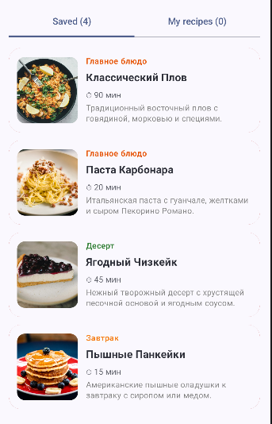
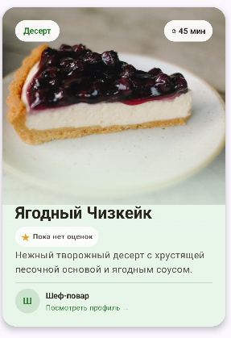
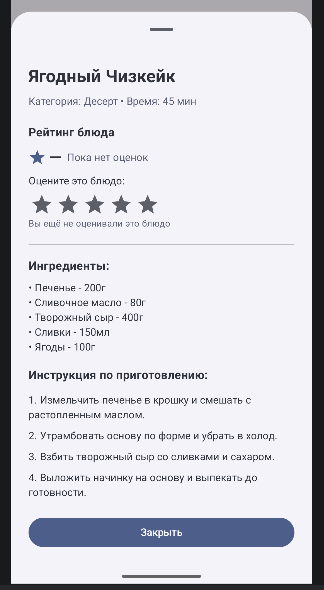
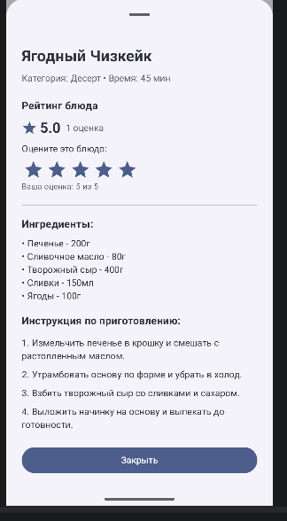

# Foodgram 🍔

**Foodgram** is an interactive Android application for discovering, browsing, and saving recipes. Users can explore recipes through an interactive card deck, search by title, filter by category, view detailed cooking instructions, and add their own recipes.

Built with **Kotlin**, **Jetpack Compose**, and **Material 3**, following the **MVVM** architecture pattern.

---

## 🚀 Features

- **Interactive Recipe Deck** — Browse recipes one card at a time and save or skip recipes.
- **Recipe Search** — Find recipes by title.
- **Category Filtering** — Filter recipes by category using Material 3 `FilterChip` components.
- **Multiple Viewing Modes** — Browse recipes in an interactive deck or a vertical list when searching or filtering.
- **Recipe Details** — View recipe descriptions, ingredients, cooking time, and step-by-step instructions in a `ModalBottomSheet`.
- **Saved Recipes** — View and manage saved recipes in the profile section.
- **Add Your Own Recipes** — Create recipes with a title, category, cooking time, description, ingredients, instructions, and an image.
- **Edit Recipes** — Update existing recipes and their information.
- **Delete Recipes** — Remove recipes with a confirmation dialog.
- **Recipe Validation** — Validate required fields when creating or editing recipes and display feedback for invalid input.
- **Recipe Ratings** — Rate recipes from 1 to 5 stars, view average ratings, and see the total number of ratings.
- **User Profiles** — View your own recipes and explore recipes associated with other authors.
- **Swipe Interactions** — Use swipe gestures to manage recipes in the profile.
- **Local Data Persistence** — Store recipes and user interactions locally using Room Database, keeping data available after restarting the application.
- **Reactive UI** — Update the interface in response to database and state changes using `ViewModel`, `StateFlow`, and Kotlin Flow.

## 🛠 Tech Stack

- **Language:** Kotlin
- **UI Framework:** Jetpack Compose
- **Design System:** Material 3
- **Architecture:** MVVM (Model–View–ViewModel)
- **State Management:** `StateFlow`, `remember`, `rememberSaveable`
- **Database:** Room Database (SQLite)
- **Data Access:** DAO (Data Access Objects)
- **Data Layer:** Repository Pattern
- **Asynchronous Programming:** Kotlin Coroutines and Flow
- **Image Loading:** Coil 3
- **Navigation:** Navigation Compose
- **Build System:** Gradle

## 🏗 Project Structure

The application is organized into several main parts:

- **Model** — Recipe data models.
- **Data** — Room database configuration, entities, DAOs, and type converters.
- **Repository** — Handles data operations and provides an abstraction between the database and ViewModels.
- **ViewModel** — Application state and recipe-related operations, exposed through `StateFlow`.
- **Screens** — Main feed, recipe creation and editing, profiles, and recipe browsing.
- **Components** — Reusable UI elements, including recipe cards and recipe detail sheets.
- **Navigation** — Navigation between application screens.
- **UI Theme** — Application colors, typography, and Material 3 styling.

## 📱 Screenshots

|                 Main Feed                 |                   Search & Categories                   |                  Recipe Details                  |
|:-----------------------------------------:|:-------------------------------------------------------:|:------------------------------------------------:|
|  |  |  |

|                Add Recipe                 |               User Profile               |                  Saved Recipes                  |
|:-----------------------------------------:|:----------------------------------------:|:-----------------------------------------------:|
|  |  |  |

### Additional Feature: Recipe Ratings

|                  Recipe Rating                  |                 Rating on Recipe Card                 |                  Updated Rating                   |
|:-----------------------------------------------:|:-----------------------------------------------------:|:-------------------------------------------------:|
|  |  |  |

## ⚙️ How to Run

1. Clone the repository:

   ```bash
   git clone https://github.com/akineverused/android_hw2.git
   ```

2. Open the project in **Android Studio**.

3. Allow Gradle to sync and download the required dependencies.

4. Start an Android emulator or connect an Android device.

5. Click **Run** in Android Studio to build and launch the application.

## 📌 Notes

- The application uses sample recipes for demonstration.
- Recipe data and user interactions are stored locally using Room Database.
- Recipe operations are handled through the Repository and DAO layers.
- Changes to recipes and ratings are observed reactively and reflected in the UI without requiring manual refresh.
- Local data persists after restarting the application.